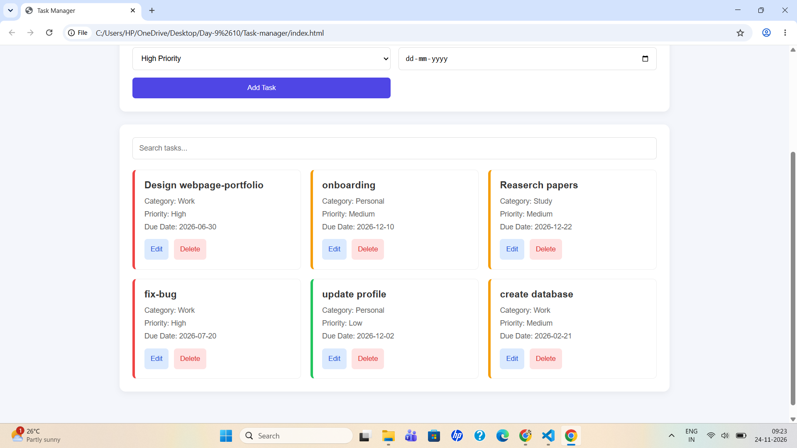

# Task Manager App

## About
A simple and responsive Task Manager application
built using HTML, CSS and JavaScript.

## Features
- Add new tasks
- Organize tasks into categories
- Set high, medium and low priorities
- Assign due dates
- Edit and delete tasks
- Search tasks
- Save tasks using localStorage
- Responsive design using CSS Grid

## Technologies Used
- HTML5
- CSS3
- JavaScript
- Browser localStorage

## Responsive Design
- Desktop layout
- Tablet layout (768px)
- Mobile layout (480px)

## Screenshot

Add your project screenshot here:

## How to Run
1. Download or clone this repository.
2. Open the project folder in VS Code.
3. Open index.html in your browser.

# My Task Manager

A simple and responsive Task Manager application built using HTML, CSS, and JavaScript.

## Features
- Add new tasks
- Organize tasks by category
- High, Medium, and Low priority colours
- Set task due dates
- Edit and delete tasks
- Search tasks
- Save tasks using localStorage
- Responsive design using CSS Grid

## Technologies Used
- HTML5
- CSS3
- JavaScript
- localStorage

## Responsive Design
- Desktop: 3 columns
- Tablet: 2 columns
- Mobile: 1 column

## Screenshot

## How to Run
1. Clone or download this repository.
2. Open the folder in VS Code.
3. Open index.html in your browser.
